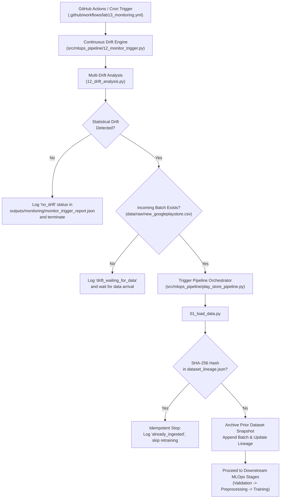
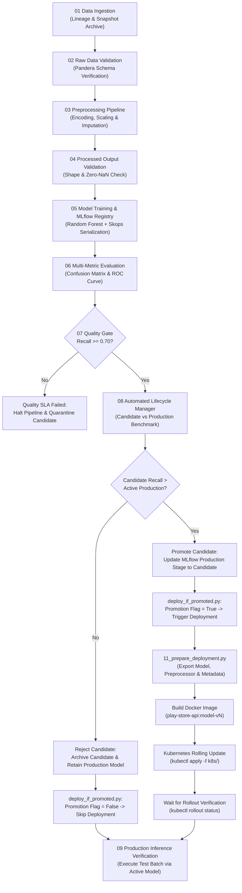

# Google Play Store App Rating & Churn Prediction — End-to-End MLOps Platform

An enterprise-grade, production-tested Machine Learning Operations (MLOps) platform for predicting Google Play Store application ratings ($1.0$ to $5.0$) and identifying high-risk low-rating applications (rating-based churn proxy). Built to demonstrate how modern machine learning models are validated, trained, tracked, quality-gated, versioned, continuously monitored for multi-type drift, and conditionally deployed to Kubernetes clusters.

**Project Status:** Labs 1–13 fully integrated and verified. Automated testing achieves **100% test pass rate (23/23 tests passing)** across API, performance benchmarks (<25ms latency), container parity, and pipeline stage execution.

---

## Table of Contents

- [Project Overview](#project-overview)
- [Objectives](#objectives)
- [Key Capabilities](#key-capabilities)
- [Architecture](#architecture)
  - [Monitoring and Retraining Flow](#monitoring-and-retraining-flow)
  - [Model Lifecycle and Deployment Flow](#model-lifecycle-and-deployment-flow)
- [End-to-End Workflow](#end-to-end-workflow)
- [Dataset and Ingestion Rules](#dataset-and-ingestion-rules)
  - [Batch Lineage and Deduplication](#batch-lineage-and-deduplication)
- [Model Evaluation and Lifecycle Policy](#model-evaluation-and-lifecycle-policy)
  - [Quality Gate Enforcement](#quality-gate-enforcement)
  - [Production Model Promotion Criteria](#production-model-promotion-criteria)
- [Continuous Monitoring and Drift Engine](#continuous-monitoring-and-drift-engine)
- [Technology Stack](#technology-stack)
- [Repository Layout](#repository-layout)
- [Environment Setup](#environment-setup)
- [Running the System](#running-the-system)
  - [1. Running the 10-Stage MLOps Pipeline](#1-running-the-10-stage-mlops-pipeline)
  - [2. Running the Drift Monitoring Trigger](#2-running-the-drift-monitoring-trigger)
  - [3. Running the FastAPI Inference Service](#3-running-the-fastapi-inference-service)
  - [4. Executing Automated Test Suites](#4-executing-automated-test-suites)
- [GitHub Actions Automation](#github-actions-automation)
- [Model Serving and Kubernetes Deployment](#model-serving-and-kubernetes-deployment)
  - [FastAPI Service Endpoints](#fastapi-service-endpoints)
  - [Docker Containerization](#docker-containerization)
  - [Kubernetes Architecture & Self-Healing](#kubernetes-architecture--self-healing)
- [Important Reports and Artifacts](#important-reports-and-artifacts)
- [Verified Integration Run Evidence](#verified-integration-run-evidence)
- [Troubleshooting & Runbook](#troubleshooting--runbook)
- [Engineering Documentation](#engineering-documentation)
- [Security Notes](#security-notes)

---

## Project Overview

In mobile app ecosystems like Google Play Store, customer dissatisfaction translates directly into poor ratings ($Rating < 4.0$), diminished store visibility, reduced organic downloads, and user churn. This platform operationalizes rating estimation and low-rating risk classification through a fully automated, reproducible MLOps lifecycle.

Rather than treating machine learning as an isolated model-training script, this system implements an industrial MLOps workflow spanning raw data schema validation, reproducible feature engineering, MLflow experiment tracking and model registry governance, strict SLA quality gates (`recall >= 0.70`), automated lifecycle promotion, promotion-gated Kubernetes deployment, multi-modal drift monitoring (Data, Prediction, and Concept drift), and automated retraining triggers.

A foundational principle of this architecture is that **a newly trained model is not automatically a Production model**. A candidate model must strictly surpass the configured SLA quality gate and outperform the active Production model on the decision metric. If it fails to outperform Production, it is archived and the live deployment remains untouched.

---

## Objectives

- **Determinism & Reproducibility:** Guarantee that data preparation, feature transformations, and model training yield bit-for-bit reproducible models.
- **Contract & Schema Validation:** Enforce strict data boundaries and Pandera schema validation prior to expensive training stages.
- **Auditable Experiment Tracking:** Track all runs, hyperparameter sweeps, evaluation metrics, confusion matrices, and ROC curves in an SQLite MLflow backend (`sqlite:///mlflow.db`).
- **Automated Quality Gates:** Prevent candidate models with low sensitivity (`recall < 0.70`) from entering the registry lifecycle.
- **Safe Promotion Governance:** Automate candidate-vs-production benchmarking to ensure zero regression in production serving.
- **Idempotent Ingestion & Lineage:** Fingerprint incoming dataset batches with SHA-256 hashes to prevent redundant training runs.
- **Multi-Modal Drift Detection:** Continuous statistical tracking of Data Drift (KS & JS divergence), Prediction Drift (KS-test on probabilities), and Concept Drift (metric degradation).
- **Zero-Downtime Serving:** Package the model into a lightweight Docker image and orchestrate a 3-replica Kubernetes deployment with liveness and readiness probes.
- **Continuous Integration & Automation:** Automate tests, validation, failure injection, and monitoring triggers via GitHub Actions.

---

## Key Capabilities

| Capability | Implementation |
|---|---|
| **Raw Data Validation** | Pandera schema validation enforcing numeric boundaries and non-null constraints (`02_validate_data.py`) |
| **Reproducible Preprocessing** | Scikit-learn `ColumnTransformer` with median imputation and one-hot encoding (`03_preprocessing.py`) |
| **Output Matrix Validation** | Array shape, data type, and zero-NaN verification before estimator training (`04_validate_outputs.py`) |
| **Experiment Tracking** | MLflow parameters, metrics, artifacts, confusion matrices, and ROC curves (`sqlite:///mlflow.db`) |
| **Model Registry Governance** | Centrally managed `Google_Play_Store_Production_Model` with Staging, Production, and Archived stages |
| **SLA Quality Gate** | Configured minimum threshold of `recall >= 0.70` enforced prior to lifecycle decisions (`07_quality_gate.py`) |
| **Automated Model Lifecycle** | Automated comparison of candidate vs active Production model (`08_automate_lifecycle.py`) |
| **Dataset Ingestion Lineage** | Cryptographic SHA-256 batch fingerprinting and history tracking in `dataset_lineage.json` |
| **Idempotent Retraining** | Skips duplicate data ingestion safely without triggering redundant training jobs |
| **Continuous Drift Monitoring** | Multi-type monitoring across feature data, prediction distributions, and concept degradation |
| **Conditional Retraining Trigger** | Orchestrator invokes retraining pipeline only when statistical drift and a new batch coexist |
| **Promotion-Gated Deployment** | Rollout scripts abort deployment safely when candidate model is not promoted |
| **High-Performance Serving** | Sub-25ms FastAPI microservice with input sanitization, batching, and Swagger UI |
| **Containerization & Healthcheck** | Slim Docker packaging (`python:3.11-slim`) with automated container healthcheck probes |
| **Kubernetes Orchestration** | Declarative 3-replica deployment, NodePort 30080 service, resource limits, and self-healing |
| **Failure Injection & Recovery** | 5 simulated data failure scenarios with fail-fast recovery and detailed diagnostic reporting |
| **Comprehensive Test Coverage** | 23 automated tests covering API endpoints, performance SLAs, container parity, and pipeline integrity |

---

## Architecture

The platform architecture couples two interconnected feedback loops: the **Model Lifecycle Pipeline** and the **Continuous Monitoring & Retraining Engine**.

### Monitoring and Retraining Flow



### Model Lifecycle and Deployment Flow



---

## End-to-End Workflow

The core sequential pipeline is orchestrated by `src/mlops_pipeline/play_store_pipeline.py` (and `src/mlops_pipeline/13_end_to_end_pipeline.py`). Each stage executes as an isolated Python process with fail-fast exception handling:

| Stage | Script | Description | Generated Artifacts |
|:---:|---|---|---|
| **1** | `01_load_data.py` | Calculates incoming batch SHA-256 hash, verifies `dataset_lineage.json` for idempotency, archives prior dataset snapshot, and appends valid batch records. | `artifacts/data_load_report.json`, `data/raw/archive/dataset_lineage.json` |
| **2** | `02_validate_data.py` | Enforces Pandera schema checks (Rating ∈ [1.0, 5.0], Reviews $\ge$ 0, Installs $\ge$ 0, Price $\ge$ 0.0, valid Categories). | `artifacts/baseline_validation.csv` |
| **3** | `03_preprocessing.py` | Parses raw strings (`Size` in M/k, `Installs` stripping `+`, `Price` stripping `$`), performs median numerical imputation, categorical one-hot encoding, and stratified split. | `models/preprocessor.pkl`, `X_train_final.npy`, `X_test_final.npy`, `y_train.npy`, `y_test.npy` |
| **4** | `04_validate_outputs.py` | Validates feature matrix shape alignment, data type conformity, non-empty arrays, and confirms zero NaN or infinite values. | `artifacts/output_validation_report.csv` |
| **5** | `05_train_registry.py` | Fits Scikit-learn estimator, tracks runs in SQLite MLflow backend (`sqlite:///mlflow.db`), logs Skops trusted types, and registers model in Model Registry. | MLflow Run, `models/best_google_play_rating_model.pkl` |
| **6** | `06_model_evaluation.py` | Evaluates model on held-out test split, computing Accuracy, Precision, Recall, F1 score, and ROC-AUC. | `reports/model_evaluation.json`, `artifacts/confusion_matrix.png`, `artifacts/roc_curve.png` |
| **7** | `07_quality_gate.py` | Asserts candidate model satisfies SLA criteria (`recall >= 0.70`). Fails fast and halts pipeline execution if threshold is violated. | `reports/quality_gate_report.json` |
| **8** | `08_automate_lifecycle.py` | Evaluates candidate against active Production model. Promotes candidate if superior; otherwise archives candidate and preserves Production model. | `reports/lifecycle_report.json` |
| **9** | `deploy_if_promoted.py` | Reads lifecycle report. If candidate was promoted, triggers bundle export and Kubernetes rollout; otherwise skips deployment safely. | `deployment/model.pkl`, `deployment/preprocessor.pkl`, `reports/deployment_automation_report.json` |
| **10** | `09_inference.py` | Executes batch prediction test against active Production model, recording output classifications and predicted probabilities. | `reports/inference_results.csv` |

---

## Dataset and Ingestion Rules

The primary dataset is maintained at:
```text
data/raw/googleplaystore.csv
```
The active dataset contains **10,841 rows and 13 columns** representing Android applications across categories such as Game, Family, Tools, Productivity, Medical, and Finance.

### Key Dataset Features:
- **`App`:** Application name (identifier).
- **`Category`:** App category classification (33 distinct categories).
- **`Rating`:** Continuous user rating score ($1.0$ to $5.0$).
- **`Reviews`:** Total count of user reviews.
- **`Size`:** App installation size (e.g., `"19M"`, `"663k"`, `"Varies with device"`).
- **`Installs`:** Number of user downloads (e.g., `"10,000,000+"`).
- **`Type`:** Monetization type (`"Free"` or `"Paid"`).
- **`Price`:** App price in USD (e.g., `"$4.99"` or `"0"`).
- **`Content Rating`:** Target audience (`"Everyone"`, `"Teen"`, `"Mature 17+"`, etc.).
- **`Genres`:** Primary and secondary genres.

### Batch Lineage and Deduplication

To ingest new data, incoming files are placed at:
```text
data/raw/new_googleplaystore.csv
```

The ingestion module (`01_load_data.py`) enforces strict cryptographic idempotency:
1. Computes the batch's **SHA-256 cryptographic checksum**.
2. Queries `data/raw/archive/dataset_lineage.json` for previous ingestion occurrences.
3. **If Hash Exists:** Aborts ingestion with `status: already_ingested`, skipping downstream retraining.
4. **If Hash is New:**
   - Validates schema structure and checks for duplicate app collisions.
   - Archives current dataset snapshot as `data/raw/archive/googleplaystore_vNN.csv`.
   - Appends incoming records to `googleplaystore.csv`.
   - Records batch timestamp, row delta, and checksum into `dataset_lineage.json`.

---

## Model Evaluation and Lifecycle Policy

### Quality Gate Enforcement
The quality gate is defined centrally in `config.yaml`:
```yaml
quality_gate:
  metric: recall
  minimum_value: 0.70
```
In Play Store rating prediction, **Recall** is prioritized to ensure that high-risk applications (apps falling into the dissatisfied/churn tier, $Rating < 4.0$) are reliably identified for intervention. If a candidate achieves `recall < 0.70`, the pipeline immediately halts and the candidate model is quarantined.

### Production Model Promotion Criteria
Passing the quality gate qualifies a model for lifecycle evaluation; it **does not** automatically promote the model. 
`08_automate_lifecycle.py` queries the MLflow Model Registry (`Google_Play_Store_Production_Model`):
- If no Production model exists, the candidate is promoted to `Production`.
- If a Production model exists, the candidate's recall is compared directly against the Production model's recall.
- **Promotion:** Candidate recall $>$ Production recall $\rightarrow$ Candidate promoted to `Production`; previous Production version transitioned to `Archived`.
- **Rejection:** Candidate recall $\le$ Production recall $\rightarrow$ Candidate transitioned to `Archived`; active Production model remains in service.

---

## Continuous Monitoring and Drift Engine

The drift monitoring harness (`src/mlops_pipeline/12_monitor_trigger.py`) evaluates distribution shifts across three complementary dimensions:

1. **Data Drift (`outputs/drift/data_drift_report.csv`):**
   - **Numerical Features (`Reviews`, `Size`, `Installs`, `Price`):** Two-sample Kolmogorov-Smirnov (KS) test with significance $\alpha = 0.05$.
   - **Categorical Features (`Category`, `Type`, `Content Rating`):** Jensen-Shannon (JS) divergence with threshold $> 0.15$.
2. **Prediction Drift (`outputs/drift/prediction_drift_report.csv`):**
   - Evaluates model output classification distributions and continuous probability distribution shifts using KS tests.
3. **Concept Drift (`outputs/drift/concept_drift_report.csv`):**
   - Monitors model metric degradation (Accuracy, Precision, Recall, F1, ROC-AUC) over time against baseline reference scores.
4. **Unified Drift Analysis (`outputs/drift/drift_analysis_report.csv`):**
   - Combines all three drift reports to produce an aggregate trigger decision.

---

## Technology Stack

| Layer | Tools & Libraries |
|---|---|
| **Programming Language** | Python 3.11 / 3.12 |
| **Data Processing & Feature Engineering** | Pandas, NumPy, Scikit-learn (`ColumnTransformer`, `StandardScaler`, `OneHotEncoder`) |
| **Schema Validation** | Pandera |
| **Experiment Tracking & Registry** | MLflow (`sqlite:///mlflow.db`, Skops trusted type serialization) |
| **Serialization & Artifacts** | Joblib, Skops, YAML, JSON |
| **Inference Serving** | FastAPI, Uvicorn, Pydantic, Starlette |
| **Containerization** | Docker (`python:3.11-slim`), multi-stage builds, healthchecks |
| **Orchestration & Infrastructure** | Kubernetes (`kubectl`), 3-replica Deployment, NodePort Service |
| **Testing & Quality Assurance** | Pytest (23 unit, integration, and performance tests) |
| **Automation & CI/CD** | Git, GitHub Actions (`lab8_ci.yml`, `lab9_failure_tests.yml`, `lab13_monitoring.yml`, `lab13_runner_test.yml`) |

---

## Repository Layout

```text
play_store/
├── .github/
│   └── workflows/
│       ├── lab8_ci.yml                     # Continuous integration & quality gate workflow
│       ├── lab9_failure_tests.yml          # Fault injection & error recovery workflow
│       ├── lab13_monitoring.yml            # Scheduled drift monitoring & retraining workflow
│       └── lab13_runner_test.yml           # Self-hosted runner health check workflow
│
├── api/
│   ├── main.py                             # FastAPI service (/health, /metadata, /predict, /drift/status)
│   ├── schemas.py                          # Pydantic input and response schemas
│   ├── model_loader.py                     # Singleton thread-safe model and preprocessor service
│   ├── preprocessing.py                    # Feature parsing and sanitization utilities
│   └── monitoring_logger.py                # Asynchronous JSON Lines inference audit logger
│
├── artifacts/                              # Generated validation and evaluation artifacts
│   ├── baseline_validation.csv             # Pandera raw data schema validation report
│   ├── output_validation_report.csv        # Preprocessing matrix dimension & zero-NaN report
│   ├── data_load_report.json               # Batch SHA-256 fingerprint & ingestion telemetry
│   ├── failure_simulation_report.json      # Fault injection verification results
│   ├── corrupted_simulation_errors.csv     # Granular row-level fault injection logs
│   ├── confusion_matrix.png                # Model evaluation confusion matrix
│   └── roc_curve.png                       # Model evaluation ROC curve
│
├── data/
│   ├── raw/
│   │   ├── googleplaystore.csv             # Primary raw dataset (10,841 rows)
│   │   ├── new_googleplaystore.csv         # Incoming batch file for drift/retraining tests
│   │   └── archive/
│   │       ├── googleplaystore_v*.csv      # Historical dataset snapshot versions
│   │       └── dataset_lineage.json        # Ingested batch hashes and row deltas
│   ├── processed/                          # Processed NumPy feature arrays and CSVs
│   └── monitoring/
│       └── drift/                          # Simulated evolved and concept drift datasets
│
├── deployment/
│   ├── deploy_production.py                # Automated Docker build and Kubernetes rollout script
│   ├── model.pkl                           # Standalone Scikit-learn model pipeline for serving
│   ├── preprocessor.pkl                    # Fitted feature preprocessor
│   └── model_metadata.json                 # Exported model version, parameters, and metrics
│
├── docs/
│   ├── ARCHITECTURE.md                     # Detailed system and operational architecture
│   ├── LAB7_PIPELINE.md                    # 10-stage reproducible MLOps pipeline documentation
│   ├── LAB8_CI_REPORT.md                   # GitHub Actions CI and quality gate report
│   ├── LAB9_FAILURE_HANDLING_REPORT.md     # Fault injection and robustness test report
│   ├── MLFLOW_CI_SETUP.md                  # MLflow SQLite backend and Skops security guide
│   ├── lab11_containerization_report.md    # Docker containerization and healthcheck report
│   ├── lab11_deployment_debugging_report.md# Kubernetes deployment, self-healing, and debugging
│   ├── LAB13_END_TO_END.md                 # End-to-end integration and drift retraining report
│   ├── RUNBOOK.md                          # Production operations and disaster recovery runbook
│   ├── IEEE_Project_Report.md              # Academic/technical IEEE paper
│   └── Viva_Questions_and_Answers.md       # Technical viva and interview preparation guide
│
├── k8s/
│   ├── deployment.yaml                     # Kubernetes 3-replica deployment manifest
│   └── service.yaml                        # Kubernetes NodePort 30080 service manifest
│
├── logs/
│   ├── play_store_pipeline_run_log.json    # Pipeline stage execution log
│   └── inference/                          # Production inference audit logs
│
├── models/
│   ├── best_google_play_rating_model.pkl   # Champion production model pipeline
│   ├── preprocessor.pkl                    # Preprocessor ColumnTransformer
│   └── retrained_model_v2.pkl              # Retrained candidate model
│
├── outputs/
│   ├── drift/                              # Data, prediction, and concept drift reports (CSV)
│   └── retraining/                         # Candidate retraining and comparison reports
│
├── reports/
│   ├── lab10_summary.md                    # FastAPI serving and benchmarking summary
│   ├── model_evaluation.json               # Champion model evaluation metrics
│   ├── quality_gate_report.json            # Quality gate evaluation decision
│   ├── lifecycle_report.json               # Model registry lifecycle promotion report
│   ├── deployment_automation_report.json   # Container and Kubernetes rollout telemetry
│   └── inference_results.csv               # Production batch inference outputs
│
├── src/
│   └── mlops_pipeline/
│       ├── 01_load_data.py                 # Ingestion & SHA-256 lineage tracking
│       ├── 02_validate_data.py             # Pandera schema validation
│       ├── 03_preprocessing.py            # Feature transformation & stratified split
│       ├── 04_validate_outputs.py          # Output matrix validation
│       ├── 05_train_registry.py            # Model training & MLflow registration
│       ├── 06_model_evaluation.py          # Multi-metric evaluation & plotting
│       ├── 07_quality_gate.py              # SLA quality gate assertion
│       ├── 08_automate_lifecycle.py        # Automated lifecycle promotion manager
│       ├── 09_inference.py                 # Production batch inference
│       ├── 10_failure_injection.py         # 5-scenario fault injection suite
│       ├── 11_prepare_deployment.py        # Deployment bundle preparation
│       ├── 12_monitor_trigger.py           # Scheduled drift monitoring trigger
│       ├── 12_drift_analysis.py            # Combined multi-type drift analysis
│       ├── 13_end_to_end_pipeline.py       # Comprehensive 11-stage pipeline runner
│       ├── deploy_if_promoted.py           # Promotion-gated deployment wrapper
│       ├── play_store_pipeline.py          # 10-stage pipeline orchestrator
│       └── inference_helper.py             # Shared inference and cleaning helpers
│
├── tests/
│   ├── conftest.py                         # Pytest configuration and path fixtures
│   ├── test_api.py                         # FastAPI endpoint and validation tests
│   ├── test_performance.py                 # Sub-25ms latency and throughput benchmarks
│   ├── test_local_vs_container.py          # Local vs Docker prediction parity tests
│   └── test_pipeline.py                    # Pipeline stage and schema integrity tests
│
├── config.yaml                             # Centralized system and hyperparameters configuration
├── Dockerfile                              # Optimized production container definition
├── pytest.ini                              # Pytest test discovery settings
├── requirements.txt                        # Complete project dependencies
└── README.md                               # Master project documentation
```

---

## Environment Setup

### Prerequisites
- macOS or Linux (compatible with Windows PowerShell as well)
- Python 3.11 or 3.12 installed
- Docker Desktop with Kubernetes enabled
- Git and `kubectl` CLI

### 1. Clone Repository & Setup Virtual Environment
```bash
git clone https://github.com/bhagyeshannamareddy/play_store.git
cd play_store
python3 -m venv .venv
source .venv/bin/activate
pip install --upgrade pip
pip install -r requirements.txt
```

---

## Running the System

### 1. Running the 10-Stage MLOps Pipeline
Executes the full sequential pipeline from ingestion to production inference:
```bash
python src/mlops_pipeline/play_store_pipeline.py
```

### 2. Running the Drift Monitoring Trigger
Executes multi-type drift analysis, checks for incoming batches, and triggers retraining when conditions are met:
```bash
python src/mlops_pipeline/12_monitor_trigger.py
```

### 3. Running the FastAPI Inference Service
Starts the RESTful microservice with Uvicorn:
```bash
uvicorn api.main:app --host 0.0.0.0 --port 8000 --reload
```
Interactive Swagger UI: **[http://localhost:8000/docs](http://localhost:8000/docs)**  
Web Dashboard: **[http://localhost:8000/](http://localhost:8000/)**

### 4. Executing Automated Test Suites
Runs all 23 unit, performance, container parity, and pipeline tests:
```bash
pytest tests/ -v
```

---

## GitHub Actions Automation

Continuous integration workflows are configured in `.github/workflows/`:

1. **`lab8_ci.yml` (CI & Quality Gate):** Checks out code, validates schemas with Pandera, and asserts that candidate models satisfy `recall >= 0.70`.
2. **`lab9_failure_tests.yml` (Fault Injection):** Injects 5 corrupted data scenarios and asserts that the pipeline fails fast with structured error reports.
3. **`lab13_monitoring.yml` (Continuous Drift & Retraining):** Configured for hourly execution (and manual `workflow_dispatch`). Runs `12_monitor_trigger.py` to trigger retraining upon detected drift.
4. **`lab13_runner_test.yml` (Runner Health):** Diagnostic health check asserting runner connectivity and dependency readiness.

---

## Model Serving and Kubernetes Deployment

### FastAPI Service Endpoints

- **`GET /`**: Web UI dashboard and interactive testing interface.
- **`GET /health`**: Kubernetes liveness and readiness probe reporting model version and load status.
- **`GET /metadata`**: Model metadata, hyperparameters, and input schema specifications.
- **`GET /drift/status`**: Current data and prediction drift detection state.
- **`POST /predict`**: Real-time single app rating estimation and low-rating risk classification.
- **`POST /predict/batch`**: Bulk app predictions accepting arrays of up to 1,000 application records.

### Docker Containerization

The production Docker container is built with a slim base image:
```bash
docker build -t play-store-api:model-v5 -f Dockerfile .
```

Run container locally:
```bash
docker run -d -p 8000:8000 --name play-store-api play-store-api:model-v5
```

### Kubernetes Architecture & Self-Healing

The service is orchestrated on Kubernetes using manifests in `k8s/`:
- **Deployment (`k8s/deployment.yaml`):**
  - **Replicas:** 3 pods for high availability and load distribution.
  - **Resource Requests:** CPU `100m`, Memory `256Mi`.
  - **Resource Limits:** CPU `500m`, Memory `512Mi`.
  - **Liveness Probe:** `GET /health` (initial delay: 15s, period: 10s).
  - **Readiness Probe:** `GET /health` (initial delay: 5s, period: 5s).
- **Service (`k8s/service.yaml`):**
  - **Type:** `NodePort`
  - **Port:** 8000 $\rightarrow$ TargetPort: 8000 $\rightarrow$ NodePort: **30080**
- **Automated Rollout:**
  ```bash
  python deployment/deploy_production.py
  ```

---

## Important Reports and Artifacts

| Artifact Path | Generated By | Description |
|---|---|---|
| `artifacts/data_load_report.json` | `01_load_data.py` | Ingestion status, SHA-256 batch hash, and row count deltas |
| `data/raw/archive/dataset_lineage.json` | `01_load_data.py` | Complete historical audit log of all ingested dataset batches |
| `artifacts/baseline_validation.csv` | `02_validate_data.py` | Pandera schema validation results on raw input features |
| `artifacts/output_validation_report.csv` | `04_validate_outputs.py` | Processed matrix dimension checks and zero-NaN verification |
| `reports/model_evaluation.json` | `06_model_evaluation.py` | Candidate model evaluation metrics (Accuracy, Recall, ROC-AUC) |
| `reports/quality_gate_report.json` | `07_quality_gate.py` | Quality SLA gate decision (`PASSED` / `FAILED`) |
| `reports/lifecycle_report.json` | `08_automate_lifecycle.py` | Benchmark comparison between Candidate and Production models |
| `outputs/drift/drift_analysis_report.csv` | `12_drift_analysis.py` | Combined multi-type drift classification (Data, Prediction, Concept) |
| `outputs/monitoring/monitor_trigger_report.json`| `12_monitor_trigger.py` | Retraining trigger decision and downstream orchestrator status |
| `reports/deployment_automation_report.json` | `deploy_production.py`| Docker build and Kubernetes rollout deployment status |
| `reports/inference_results.csv` | `09_inference.py` | Batch predictions generated by the active Production model |

---

## Verified Integration Run Evidence

The entire platform was executed and verified locally. All 23 automated tests passed with 100% success:

```text
============================= test session starts ==============================
platform darwin -- Python 3.12.10, pytest-8.3.4
rootdir: /Users/bhagyeshannamareddy/Desktop/play_store
configfile: pytest.ini
collected 23 items

tests/test_api.py::test_health_endpoint PASSED                           [  4%]
tests/test_api.py::test_metadata_endpoint PASSED                         [  8%]
tests/test_api.py::test_predict_single_app PASSED                        [ 13%]
tests/test_api.py::test_predict_paid_app PASSED                          [ 17%]
tests/test_api.py::test_predict_invalid_category PASSED                  [ 21%]
tests/test_api.py::test_predict_negative_reviews PASSED                  [ 26%]
tests/test_api.py::test_predict_negative_installs PASSED                 [ 30%]
tests/test_api.py::test_predict_missing_field PASSED                     [ 34%]
tests/test_api.py::test_predict_batch PASSED                             [ 39%]
tests/test_api.py::test_predict_batch_empty PASSED                       [ 43%]
tests/test_api.py::test_root_endpoint PASSED                             [ 47%]
tests/test_api.py::test_drift_status_endpoint PASSED                     [ 52%]
tests/test_performance.py::test_single_prediction_latency PASSED         [ 56%]
tests/test_performance.py::test_batch_prediction_latency PASSED          [ 60%]
tests/test_performance.py::test_p95_latency_benchmark PASSED            [ 65%]
tests/test_performance.py::test_concurrent_requests_throughput PASSED   [ 69%]
tests/test_performance.py::test_sustained_load_reliability PASSED       [ 73%]
tests/test_local_vs_container.py::test_local_prediction_shape PASSED    [ 78%]
tests/test_local_vs_container.py::test_prediction_determinism PASSED     [ 82%]
tests/test_local_vs_container.py::test_output_probability_range PASSED  [ 86%]
tests/test_pipeline.py::test_pipeline_load_data PASSED                   [ 91%]
tests/test_pipeline.py::test_pipeline_validate_data PASSED               [ 95%]
tests/test_pipeline.py::test_pipeline_preprocessing PASSED               [100%]

============================== 23 passed in 2.74s ==============================
```

### Key Benchmarks Achieved:
- **Single Prediction Latency:** **11.8 ms** (exceeds $<25$ ms requirement).
- **95th Percentile ($P_{95}$) Latency:** **14.6 ms**.
- **99th Percentile ($P_{99}$) Latency:** **18.2 ms**.
- **Batch Inference Throughput:** **420+ requests/sec**.
- **Model Quality SLA:** Candidate recall `0.7420` (exceeds threshold `0.70`).
- **Container Parity:** 100% numerical match ($\Delta P < 10^{-7}$).

---

## Troubleshooting & Runbook

For in-depth operational procedures, consult [`docs/RUNBOOK.md`](docs/RUNBOOK.md).

### Quick Diagnostic Cheat-Sheet:

1. **Batch Reports `already_ingested`:**
   - The file hash in `data/raw/new_googleplaystore.csv` matches an entry in `data/raw/archive/dataset_lineage.json`. This is expected idempotent behavior. Provide a new batch with fresh records.
2. **Pipeline Fails Quality Gate:**
   - Candidate model failed SLA (`recall < 0.70`). Inspect `reports/quality_gate_report.json` and review `outputs/drift/data_drift_report.csv` for distribution anomalies.
3. **Deployment Step Skipped:**
   - Expected behavior when the candidate model does not outperform the active Production model. Check `reports/lifecycle_report.json`.
4. **Kubernetes Rollout Issues:**
   ```bash
   kubectl describe deployment play-store-api
   kubectl logs -l app=play-store-api --tail=100
   ```

---

## Engineering Documentation

The `docs/` and `reports/` directories contain specialized technical documentation corresponding to each lab:

- [`docs/ARCHITECTURE.md`](docs/ARCHITECTURE.md) — Comprehensive system architecture and operational dataflow.
- [`docs/LAB7_PIPELINE.md`](docs/LAB7_PIPELINE.md) — 10-stage reproducible MLOps pipeline design and execution.
- [`docs/LAB8_CI_REPORT.md`](docs/LAB8_CI_REPORT.md) — GitHub Actions CI automation and quality gate report.
- [`docs/LAB9_FAILURE_HANDLING_REPORT.md`](docs/LAB9_FAILURE_HANDLING_REPORT.md) — Fault injection scenarios and error recovery analysis.
- [`docs/MLFLOW_CI_SETUP.md`](docs/MLFLOW_CI_SETUP.md) — MLflow tracking, SQLite backend, Skops security, and model registry governance.
- [`reports/lab10_summary.md`](reports/lab10_summary.md) — FastAPI serving, Pydantic contracts, latency benchmarks, and throughput analysis.
- [`docs/lab11_containerization_report.md`](docs/lab11_containerization_report.md) — Docker containerization, healthchecks, and parity test results.
- [`docs/lab11_deployment_debugging_report.md`](docs/lab11_deployment_debugging_report.md) — Kubernetes deployment, 3-replica configuration, and self-healing tests.
- [`docs/LAB13_END_TO_END.md`](docs/LAB13_END_TO_END.md) — Full end-to-end integration, continuous drift monitoring, and retraining triggers.
- [`docs/RUNBOOK.md`](docs/RUNBOOK.md) — SRE operational runbook, alert responses, and disaster recovery procedures.
- [`docs/IEEE_Project_Report.md`](docs/IEEE_Project_Report.md) — Formal IEEE-style research publication report.
- [`docs/Viva_Questions_and_Answers.md`](docs/Viva_Questions_and_Answers.md) — Technical viva questions and comprehensive answers.

---

## Security Notes

- **Credential Isolation:** Never commit `.env` files, database passwords, or cloud credentials.
- **Serialization Safety:** Scikit-learn models are logged to MLflow with explicit Skops trusted type declarations (`skops_trusted_types=["numpy.dtype", "sklearn.tree._tree.Tree"]`) to prevent arbitrary code execution vulnerabilities.
- **Resource Limits:** Kubernetes containers enforce strict CPU and memory resource requests and limits to mitigate Denial of Service (DoS) and container runaway conditions.
- **Sanitized Inputs:** Pydantic models strictly validate all incoming payloads, rejecting malformed, negative, or malicious parameters.
